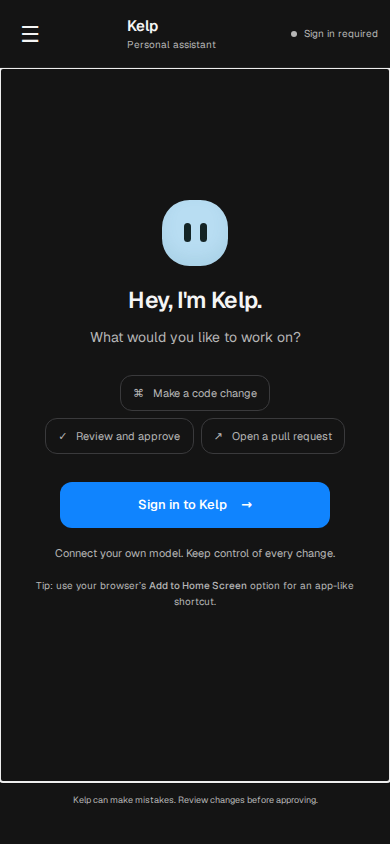
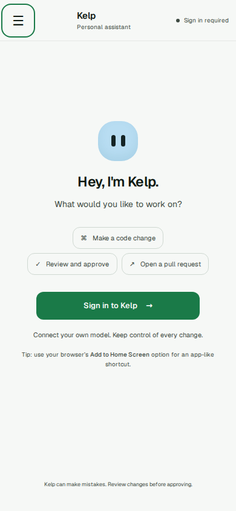
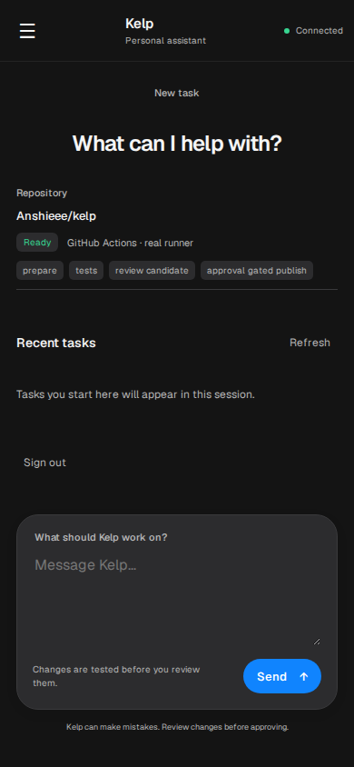
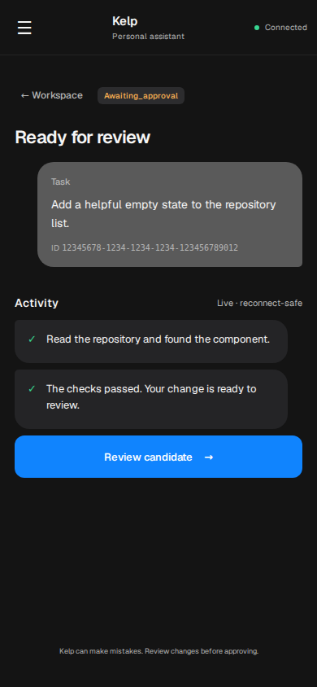
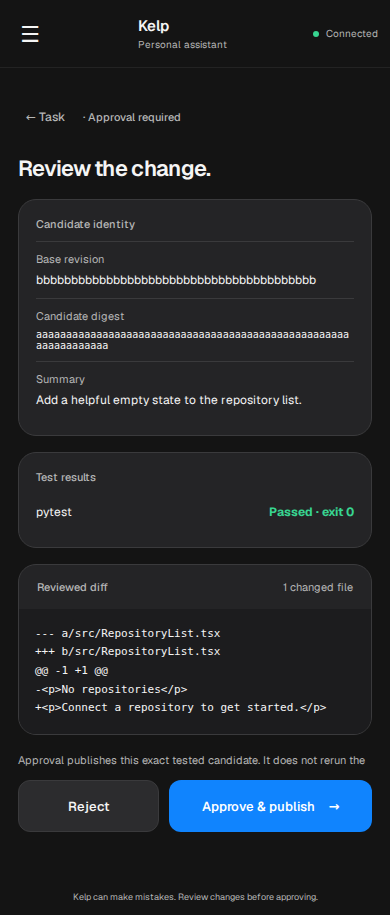
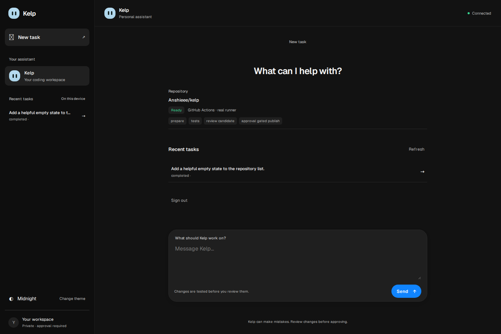

# Mobile demo fallback

The static phone UI is served from `/mobile/` and consumes the shared
[v1 facade](HACKATHON_DEMO_CONTRACT.md). It has no bundled backend, mock data,
fixture mode, or desktop-preview controls. Backend endpoint implementations and
deployment must come from the separate Plan B backend branch; the client must
not be deployed as a functioning demo until the shared facade is live.

## Local preview and checks

No build step or dependency install is needed. From the repository root:

```sh
python -m http.server 8080 --directory netlify
# Visit http://localhost:8080/mobile/ (sign-in/API flows require deployed HTTPS)
node --check netlify/mobile/app.js
node --check netlify/mobile/sw.js
node --test tests/mobile-demo.test.mjs
```

Netlify's existing `publish = "netlify"` publishes this directory at `/mobile/`.
The service worker caches only versioned public shell files and never caches API
responses. To ship shell changes, increment the `v=` asset references in
`index.html`, the service worker cache name, and its explicit shell URLs together.

## Demo deployment requirements

Enable Netlify Identity and configure the v1 backend on the same HTTPS origin.
Set environment variable names below in the backend's secret/configuration store;
**never put their values in this repository, app bundle, or PR**. The frontend
needs no provider-key environment variable and asks the signed-in user to enter
their OpenRouter key transiently.

- Netlify backend: `DATABASE_URL`, `NETLIFY_IDENTITY_JWT_SECRET`,
  `DEMO_KEY_ENCRYPTION_SECRET`, `DEMO_WORKER_TOKEN`, `GITHUB_REPOSITORY`,
  `DEMO_ALLOWED_REPOS`, `DEMO_ALLOWED_SUBJECTS`, `GITHUB_DISPATCH_TOKEN`.
- GitHub Actions backend: `DEMO_API_BASE`, `DEMO_READ_TOKEN`,
  `DEMO_REPO_TOKEN`, `DEMO_WORKER_TOKEN`.
- Optional backend default model: `DEMO_DEFAULT_MODEL`.

See `docs/KELP_DEMO_BACKEND.md` on the backend implementation branch for exact
deployment meanings and setup requirements. Do not wire credentials into the
browser or actions workflow inputs.

Task history is limited to IDs created in the current browser session because the
facade intentionally has no list-history endpoint. Reconnect restores a selected
task by its session-scoped ID and resumes events after its last sequence cursor.
Neither prompts nor provider keys are persisted. Approval shows the actual
candidate diff, test evidence, base SHA and digest; results show a PR only when
the backend reports a real HTTPS URL and commit SHA. The backend contract does
not advertise computer preview, so the phone UI does not offer it.

See [reuse and attribution review](MOBILE_REUSE_NOTES.md) for the five-minute
upstream inventory, commit ID, license attribution and reuse scope.


## OpenMausBot-style interface

The mobile client now uses OpenMausBot's Midnight and Meadow palette values, compact chat header, conversation drawer, desktop sidebar and rounded composer. It remains a Kelp task client over the same API. Theme selection is available in the sidebar. On phones, open the conversation menu to switch themes or reopen a task from this browser session. The menu supports Escape, focus return and keyboard focus containment.

All screenshots below use isolated API fixtures, not a live account or real PR. They show the actual rendered client. No sample state is shipped in the production app.

| Midnight phone | Meadow phone |
| --- | --- |
|  |  |






Browser smoke test (install Playwright in a temporary tools directory if it is not already available):

```sh
npm install --prefix /tmp/kelp-ui-tools playwright
/tmp/kelp-ui-tools/node_modules/.bin/playwright install chromium
NODE_PATH=/tmp/kelp-ui-tools/node_modules node tests/browser/mobile-ui.cjs
```

The smoke test starts an ephemeral localhost server, intercepts auth and API calls with isolated responses, and checks the drawer, Escape, themes, workspace, task submission, candidate review, approval/result, and horizontal overflow at 320/390/768/1440 pixels. It refreshes screenshots in `docs/mobile-preview`. `KELP_BROWSER_EXECUTABLE` optionally selects an already installed Chromium executable. This does not verify live identity configuration, remote execution, or GitHub permissions.
