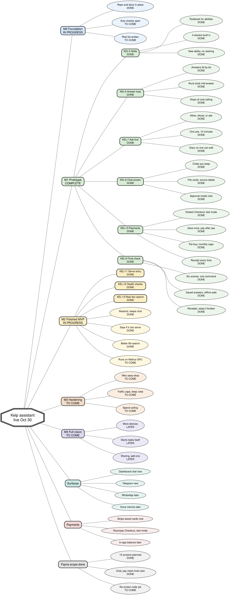

# SDLC mind map — Always-On Private Assistant

Snapshot: 29 October 2026
Program target: **30 October 2026** for M0 through M4
Tracker site: [`netlify/index.html`](../netlify/index.html)

This file is the written record of the delivery. It answers three questions in plain words:
what the build is made of, how far each piece has got, and where the evidence lives. The picture
that goes with it is [`sdlc-mindmap.svg`](sdlc-mindmap.svg), with a PNG fallback at
`sdlc-mindmap.png`. Both are static files, so the diagram looks the same everywhere. The tracker
site embeds a copy of the SVG directly in the page, so every box there can be clicked; that copy
and these two files must be updated together.

## How to read the labels

| Label | What it means |
|---|---|
| **DONE** | Finished and merged into the shared copy of the code, or finished on its branch and ready to merge. |
| **IN PROGRESS** | Being built right now. |
| **TO COME** | Agreed, not started. |

An **M number** is a milestone, a stage of the build. A **KEL number** is a work item in Linear,
our task tracker. Linear can lag behind by a day; the statuses below match the tracker site on the
snapshot date.

## The map

The same map in words, in case the image does not load:

- **Milestones** — five stages, M0 to M4.
- **The work** — six work items, KEL-5 to KEL-10.
- **Surfaces** — where you talk to the assistant: dashboard first, Telegram next, WhatsApp and voice memos later.
- **Money** — Stripe now, Razorpay and an in-app balance later.
- **Design** — the screen plan is written; the drawing file is next.

On the tracker site ([`netlify/index.html`](../netlify/index.html)) the same SVG is embedded
inside the page rather than loaded as a picture. Each box is a link: activating it opens the
matching milestone, work item, or decision below. M2 to M4 are drawn on the map as well. The
static `.svg` and `.png` files are still the source of the picture.

## Milestones

Every milestone currently points at the same date. Treat that as the program target, not a
promise that full-vision scope lands this week. Scope is cumulative: M2 includes everything in M1.

| Stage | Target | State | What finishing it means |
|---|---|---|---|
| **M0 Foundation** | 30 Oct 2026 | IN PROGRESS | Repo and docs in place, the checks that run on every change, a standard development setup, model and provider chosen, and a written list of what could go wrong. The repo, docs, tests, and skill contract are in. The rest is still open. |
| **M1 Prototype** | 30 Oct 2026 | IN PROGRESS | The end-to-end story: ask, get an answer with sources, read a file, approve an action, pay with a saved card, watch the six-scene demo. All six work items live here. |
| **M2 Polished MVP** | 30 Oct 2026 | TO COME | Survives ordinary use: picks up after a restart, self-checks, better search over your documents, repeatable quality measurements, and a deploy on the Nebius GPU. |
| **M3 Hardening** | 30 Oct 2026 | TO COME | The privacy and cost promises hold under pressure: who sees what, where keys live, caps on traffic, a retention rule, and a spend ceiling. |
| **M4 Full vision** | 30 Oct 2026 | TO COME | More devices, work the assistant starts on its own, abilities added by others, and team sharing. A direction, not a deadline. |

## The six work items

KEL-5 feeds KEL-6 and KEL-7. Those two feed KEL-8. KEL-7 also feeds KEL-10. KEL-8 and KEL-10
come before the demo, KEL-9.

### KEL-5 — Skill contracts — DONE

The rulebook every new ability follows: what it does, what it takes in, what it gives back, and
what it is allowed to touch. Four starter abilities sit on top of it: web search, reading GitHub,
answering from PDFs and spreadsheets, and creating a scheduled job.

*Why it matters:* adding an ability becomes a small, contained job instead of a rewiring of the
assistant, and the safety layer knows what a tool intends to do before it runs.

*Plain words:* a **schema** is the shape of the data, written down so a machine can check it. A
**manifest** is the label on the box: what is inside and what it needs.

- Linear: https://linear.app/kelp-ai/issue/KEL-5/skill-contracts-schema-capability-manifest-4-prototype-skills
- Contract: [`docs/SKILL_SPEC.md`](SKILL_SPEC.md)
- Schema: [`skills/manifest.schema.json`](../skills/manifest.schema.json)
- Tests: [`tests/test_skill_loader.py`](../tests/test_skill_loader.py)

### KEL-6 — Kernel loop — IN PROGRESS

The engine. It reads your message, asks the model what to do, streams the answer to you while it
is still being written, runs a tool when one is needed, feeds the result back, and stops at a
ceiling on steps and length. It also keeps a tally of what each turn costs.

*Why it matters:* the chat screen, the approval step, the wallet, and the demo all plug into this
loop.

*Plain words:* **streaming** means showing words as they arrive. A **tool call** is the assistant
asking a small program to do one specific thing. A **token** is a word-sized chunk of text, and
price is counted per chunk.

- Linear: https://linear.app/kelp-ai/issue/KEL-6/kernel-llm-streaming-agent-loop-with-tool-calling
- Design: [`docs/KERNEL.md`](https://github.com/Anshieee/kelp/blob/kel-6/docs/KERNEL.md) (kel-6 branch)
- Loop: [`kernel/loop.py`](https://github.com/Anshieee/kelp/blob/kel-6/kernel/loop.py)
- Tests: [`tests/test_kernel_loop.py`](https://github.com/Anshieee/kelp/blob/kel-6/tests/test_kernel_loop.py)

Status detail: built on the `kel-6` branch with tests. Not merged into `main` yet.

### KEL-7 — Approval gate — IN PROGRESS

The check at the door. Before anything that changes something, this layer decides: allow, refuse,
or stop and ask you. Asking creates a one-time request that names exactly what will run and
expires after ten minutes. Every decision and result goes into a log that cannot be edited, with
keys and passwords removed.

*Why it matters:* a private assistant is only trustworthy if it cannot act behind your back. The
wallet and the demo both depend on this gate.

*Plain words:* an **audit log** is a diary that can only be added to. **Deny by default** means if
the rules say nothing, the answer is no.

- Linear: https://linear.app/kelp-ai/issue/KEL-7/openshell-approval-gated-tool-execution-audit
- Design: [`docs/OPENSHELL.md`](https://github.com/Anshieee/kelp/blob/kel-7/docs/OPENSHELL.md) (kel-7 branch)
- Policy: [`openshell/policy.py`](https://github.com/Anshieee/kelp/blob/kel-7/openshell/policy.py)
- Tests: [`tests/test_openshell_approvals.py`](https://github.com/Anshieee/kelp/blob/kel-7/tests/test_openshell_approvals.py)

Status detail: policy, one-time approvals, gated execution, audit log, and tests are on the
`kel-7` branch. Not merged yet.

### KEL-8 — Dashboard chat — TO COME

The main screen. Conversations you can name and pick up later, answers that appear as they are
written, a small openable card for each tool step, previews of PDF and spreadsheet answers, labels
showing where an answer came from, and approval requests shown in the conversation itself.

*Why it matters:* it is the front door. Nothing else can be shown to a person until this exists.

- Linear: https://linear.app/kelp-ai/issue/KEL-8/dashboard-chat-surface-primary-interface
- Screen plan: [`docs/frontend-scope-simple.md`](frontend-scope-simple.md)

Status detail: starts once KEL-6 and KEL-7 are merged. Screen code starts once the drawing file
exists.

### KEL-10 — Wallet — TO COME

Saved cards through Stripe: save once, list, a per-purchase cap, a monthly cap, a confirmation
window, and a receipt. Every payment passes through the KEL-7 approval step, so nothing is
charged without a yes.

*Why it matters:* paying is the clearest case of something the assistant must never do on its own.

*Plain words:* **Stripe** is the payment company that stores card details, so the app never holds
them. **SetupIntent** is Stripe's name for the one-time step that saves a card for later.

- Linear: https://linear.app/kelp-ai/issue/KEL-10/wallet-stripe-saved-cards-setupintent-attach-list-propose-approve
- Placeholder: [`payments/stripe_wallet.py`](https://github.com/Anshieee/kelp/blob/kel-7/payments/stripe_wallet.py) (kel-7 branch)

Status detail: only a placeholder settings file exists today. No real Stripe calls yet. Razorpay
and an in-app balance are outside this round.

### KEL-9 — Demo run — TO COME

Six short scenes played in order by one command: ask and get sources; summarise a PDF and answer a
spreadsheet question; look up a GitHub issue; approve a write and see it in the log; schedule a
job; stop the server mid-answer and resume without losing anything. It takes screenshots and stops
with an error if a scene fails.

*Why it matters:* it is both the proof and the guard rail. A regression breaks the script before it
reaches a person.

*Plain words:* a **fixture** is a saved, make-believe model answer, so the run is repeatable and
works offline.

- Linear: https://linear.app/kelp-ai/issue/KEL-9/demo-choreography-6-beat-scripted-end-to-end-run-npm-run-demo
- Repository: https://github.com/Anshieee/kelp (no demo script yet)

Status detail: runs last, after the dashboard and the wallet.

## Decisions that shape the map

### Surfaces

- **Dashboard, now.** The main surface, and the place every flow is designed.
- **Telegram, next.** A mirror of the same assistant, under the same rules and the same approval step.
- **WhatsApp, later.** Not in this round. Older notes that call it the main mirror are out of date.
- **Voice memos, later.** No recording or listening work yet.

### Money

- **Stripe, now.** Saved cards with a per-purchase cap, a monthly cap, a confirmation window, and a
  receipt. Tracked by KEL-10.
- **Razorpay, later.** No integration in this prototype.
- **In-app balance, later.** Showing a balance, topping it up, and keeping a ledger all wait.

### Design

- **The screen plan is done.** Thirteen screens, three main flows, four states per screen. See
  [`docs/frontend-scope-simple.md`](frontend-scope-simple.md).
- **The drawing file is next.** No screen code until it exists.

## Where everything lives

### GitHub

- Repository: https://github.com/Anshieee/kelp
- Shared copy of the code: https://github.com/Anshieee/kelp/tree/main
- All branches: https://github.com/Anshieee/kelp/branches
- Change history: https://github.com/Anshieee/kelp/commits/main
- Pull requests: https://github.com/Anshieee/kelp/pulls

### Linear

- Project, Always-On Private Assistant:
  https://linear.app/kelp-ai/project/always-on-private-assistant-23297ecfd7f0
- Work items:
  [KEL-5](https://linear.app/kelp-ai/issue/KEL-5/skill-contracts-schema-capability-manifest-4-prototype-skills),
  [KEL-6](https://linear.app/kelp-ai/issue/KEL-6/kernel-llm-streaming-agent-loop-with-tool-calling),
  [KEL-7](https://linear.app/kelp-ai/issue/KEL-7/openshell-approval-gated-tool-execution-audit),
  [KEL-8](https://linear.app/kelp-ai/issue/KEL-8/dashboard-chat-surface-primary-interface),
  [KEL-9](https://linear.app/kelp-ai/issue/KEL-9/demo-choreography-6-beat-scripted-end-to-end-run-npm-run-demo),
  [KEL-10](https://linear.app/kelp-ai/issue/KEL-10/wallet-stripe-saved-cards-setupintent-attach-list-propose-approve)

### Docs and code

- Mind map image: [`docs/sdlc-mindmap.svg`](sdlc-mindmap.svg), PNG fallback `docs/sdlc-mindmap.png`
- Tracker site: [`netlify/index.html`](../netlify/index.html)
- Skill contract: [`docs/SKILL_SPEC.md`](SKILL_SPEC.md)
- Kernel design: [`docs/KERNEL.md`](https://github.com/Anshieee/kelp/blob/kel-6/docs/KERNEL.md) (kel-6 branch)
- Approval gate design: [`docs/OPENSHELL.md`](https://github.com/Anshieee/kelp/blob/kel-7/docs/OPENSHELL.md) (kel-7 branch)
- ADR 0001, one document skill: [`docs/adr/0001-docs-answer-single-skill.md`](adr/0001-docs-answer-single-skill.md)
- Screen plan: [`docs/frontend-scope-simple.md`](frontend-scope-simple.md)
- Issue pack: [`docs/linear-issue-pack-kel.md`](linear-issue-pack-kel.md)
- Linear setup notes: [`docs/linear-setup.md`](linear-setup.md)
- Manifest schema: [`skills/manifest.schema.json`](../skills/manifest.schema.json)
- Loader: [`skills/loader.py`](../skills/loader.py)
- Contract tests: [`tests/test_skill_loader.py`](../tests/test_skill_loader.py)

## Keeping this true

1. When a work item moves, change it here, in Linear, and on the tracker site in the same pass.
2. When a branch merges, move the item to DONE and link the merge commit.
3. When a date or the scope changes, change the milestone table, the Graphviz source
   `docs/sdlc-mindmap.gv`, and the rendered `docs/sdlc-mindmap.svg` and `.png` together. The
   tracker site carries its own copy of the SVG inline, so paste the new rendering into
   `netlify/index.html` in the same pass. The picture and the words must agree.
4. Deployment is handled separately. This repository does not publish the tracker.

## Words used here

- **SDLC** — software development life cycle: the whole trip from an idea to something shipped and looked after.
- **Milestone** — a stage of the build, not a feature.
- **Repo** — the project folder kept on GitHub, with its full history. **main** is the shared copy.
- **Branch** — a separate copy where new work is prepared before it joins main.
- **Kernel** — the thinking loop: read the message, decide, act, answer.
- **Manifest and schema** — the label on a tool's box, and the shape of the data inside it.
- **Approval gate** — a checkpoint that asks you before an action, and a yes that works once.
- **Fixture** — a saved sample answer, used so a test runs the same way every time.
- **Eval** — a repeatable test of answer quality, not just whether the code runs.
- **GPU** — the chip that runs large models quickly. Nebius provides ours.
