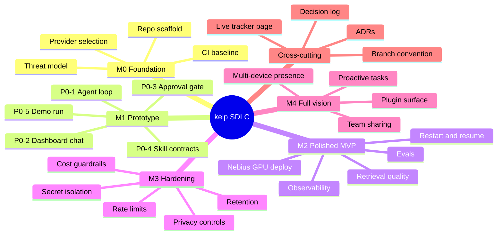
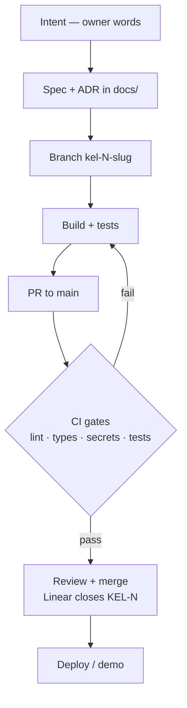
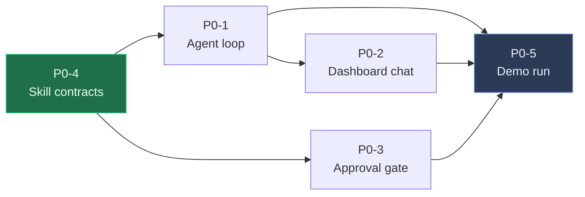

# kelp — SDLC mindmap

> **What this is.** A one-page map of how work moves through this repo: milestones, the
> dependency order of the M1 prototype slices, the artifacts each phase depends on, and the
> conventions that keep them linked. It is a navigation aid, not a process gate.
>
> **Live version (renders the diagrams):** <https://kelp-sdlc.netlify.app>
>
> **Status:** living document, last synced 2026-10-28 against `main`.
> **Sources of truth:** [`linear-issue-pack-kel.md`](./linear-issue-pack-kel.md) for issue
> content and Linear state, [`SKILL_SPEC.md`](./SKILL_SPEC.md) for the skill contract,
> [`adr/`](./adr/) for decisions that changed the plan.

---

## 1. The lifecycle at a glance

## 2. How a change travels

Two rules make the map work in practice:

1. **The branch names the issue.** `kel-<n>-<slug>` is the only prefix Linear auto-links.
   A `neb-` prefix fails silently — see
   [`linear-issue-pack-kel.md` §7](./linear-issue-pack-kel.md#7-git--github--linear-integration--required-steps).
2. **The spec carries the reading list.** A slice is done when its acceptance criteria are
   demonstrable, not when the diff looks reasonable.

## 3. M1 slice dependency graph

Read it as: **the contract lands first**, the loop and the gate depend on it, the chat surface
depends on the loop, and the demo depends on all four. P0-5 is the prototype exit test — every
beat is a prototype feature, so it cannot be pulled forward.

| Slice | Title | Blocked by | Blocks |
|---|---|---|---|
| [P0-4](./linear-issue-pack-kel.md#p0-4--skill-contracts-schema--capability-manifest--4-prototype-skills) | Skill contracts: schema + capability manifest | — | P0-1, P0-3 |
| [P0-1](./linear-issue-pack-kel.md#p0-1--kernel-llm-streaming-agent-loop-with-tool-calling) | Kernel LLM: streaming agent loop with tool calling | P0-4 | P0-2, P0-5 |
| [P0-3](./linear-issue-pack-kel.md#p0-3--openshell-approval-gated-tool-execution--audit) | OpenShell: approval-gated execution + audit | P0-4 | P0-5 |
| [P0-2](./linear-issue-pack-kel.md#p0-2--dashboard-chat-surface-primary-interface) | Dashboard chat surface | P0-1 | P0-5 |
| [P0-5](./linear-issue-pack-kel.md#p0-5--demo-choreography-6-beat-scripted-end-to-end-run-npm-run-demo) | Demo choreography: 6-beat end-to-end run | P0-1, P0-2, P0-3, P0-4 | — |

**Landed so far:** P0-4 (`KEL-5`) — contract spec, loader, four manifests, and contract tests.
See [`SKILL_SPEC.md`](./SKILL_SPEC.md), [`skills/manifest.schema.json`](../skills/manifest.schema.json),
and [`tests/test_skill_loader.py`](../tests/test_skill_loader.py).

## 4. Milestones and exit criteria

| # | Milestone | Target | Exit means |
|---|---|---|---|
| M0 | Foundation | 2026-11-07 | Repo, CI baseline, threat model, and model/provider choice recorded |
| M1 | Prototype | 2026-11-28 | Query → tool → answer loop, approvals, dashboard chat, `npm run demo` green under 4 min |
| M2 | Polished MVP | 2026-12-19 | Restart/resume, retrieval quality, evals, observability, deployed on Nebius GPU |
| M3 | Hardening | 2027-01-23 | Privacy controls, secret isolation, rate limits, retention, cost guardrails |
| M4 | Full vision | 2027-03-06 | Multi-device presence, proactive tasks, plugin surface, team sharing |

Targets are placeholders pending owner confirmation (see the pack's milestone notes).

## 5. Decisions that shaped the map

| ID | Decision | Effect on SDLC |
|---|---|---|
| Q7 | Dashboard primary; WhatsApp is a mirror, P1 | One surface to build in M1; mirror is an adapter, not a parallel track |
| Q8 | Prototype cut: chat, PDF/CSV answers, read-only `web.search` + `github.read`, approvals, scheduler | Fixes the P0-2 scope and the four prototype skills |
| Q9 | Saved cards via Stripe vault | **Superseded by Q18** |
| Q10 | Voice memo P1 only | Keeps audio capture out of M1 |
| Q18 | Payments: Stripe now, Razorpay deferred, balance P2 | Wallet scope is Stripe-only; no Razorpay branch in M1 |

The `docs.answer` one-skill-vs-two decision is recorded in
[`adr/0001-docs-answer-single-skill.md`](./adr/0001-docs-answer-single-skill.md).

## 6. Artifact map

| Artifact | Purpose | Link |
|---|---|---|
| Issue pack | Create-ready Linear structure and P0 issue bodies | [`linear-issue-pack-kel.md`](./linear-issue-pack-kel.md) |
| Earlier plan | Original `NEB`-targeted plan, kept for rationale | [`linear-p0-plan.md`](./linear-p0-plan.md) |
| Skill contract | Manifest + handler contract, invariants, error envelope | [`SKILL_SPEC.md`](./SKILL_SPEC.md) |
| ADR | Decision records | [`adr/`](./adr/) |
| Frontend brief | Screens and flows for Figma | [`frontend-scope-simple.md`](./frontend-scope-simple.md) |
| Linear setup | Workspace/team verification notes | [`linear-setup.md`](./linear-setup.md) |
| Contract tests | Loader and validation tests | [`tests/test_skill_loader.py`](../tests/test_skill_loader.py) |

## 7. Conventions

- **Branch:** `kel-<n>-<slug>` off `main`; `main` stays releasable.
- **Commit:** imperative subject, scope in parentheses, issue key in the body when useful.
- **PR:** state the acceptance criterion exercised, the commands run, and what was *not*
  verified. No force push, no secrets in diffs.
- **CI baseline:** secret scan, lint, typecheck, unit tests. A `demo` workflow is added only
  after P0-5 exists.
- **Deploy:** the tracker page is a static site from [`netlify/`](../netlify/) — no build step,
  no secrets in the client.

## 8. Open manual steps

These cannot be done by an agent with the current scopes:

- Create the Linear project, milestones, labels, and P0 issues — the pack is create-ready but
  the docs record it as *not yet created*; verify in Linear before assuming otherwise.
- Linear ↔ GitHub app installation and auto-close rules (workspace admin).
- Branch protection on `main` requiring PR + CI and blocking force pushes.
